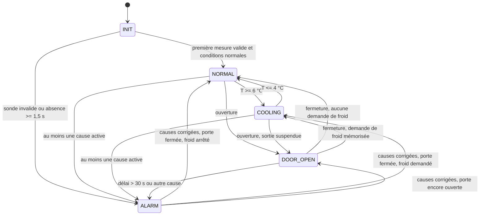

# S.C.C.S. — Surveillance d'une chambre froide

Mini-projet Systèmes programmables, 2GII, année 2026–2027.
ESP32, framework Arduino, VS Code, PlatformIO et Wokwi.

Auteur : **Wannes Fraj — 2ème GII 3**.

[Ouvrir la simulation Wokwi](https://wokwi.com/projects/480161896292697089).

[Dépôt GitHub du projet](https://github.com/wannesfraj/Smart-Cold-Chain-Storage-Monitoring-System-).

## Démarrage dans VS Code

1. Ouvrir **ce dossier complet** dans VS Code.
2. Installer les extensions recommandées : PlatformIO IDE et Wokwi Simulator.
3. Compiler avec le bouton **Build** de PlatformIO, ou `Ctrl+Maj+B`.
4. Appuyer sur `F1`, puis choisir **Wokwi: Start Simulator**.
5. Dans le circuit, cliquer sur le DS18B20 pour changer sa température. La porte est fermée lorsque l'interrupteur est à gauche ; à droite, elle est ouverte.

L'extension Wokwi peut demander sa propre activation. Aucune clé personnelle n'est incluse dans le projet.
`wokwi.toml` charge directement le programme compilé par PlatformIO.

Depuis PowerShell, dans ce dossier :

```powershell
.\demarrer.ps1
.\demarrer.ps1 -Action Test
.\demarrer.ps1 -Action Pack
```

Si PowerShell bloque un script local, les commandes directes sont :

```powershell
& "$env:USERPROFILE\.platformio\penv\Scripts\platformio.exe" run
python tools/test_project.py
```

Dans un terminal PlatformIO, `pio run` suffit également. Les dépendances sont téléchargées lors de la première compilation. Aucun circuit physique n'est nécessaire.

## Matériel et câblage

| Élément | Broche ESP32 | Connexion / rôle |
|---|---:|---|
| DS18B20 : DQ | 4 | Température de stockage ; pull-up 4,7 kΩ vers 3,3 V |
| DHT22 : SDA | 16 | Température / humidité ambiantes ; pull-up 10 kΩ vers 3,3 V |
| Interrupteur : borne 2 | 27 | `INPUT_PULLUP` ; borne 1 à GND, borne 3 libre |
| LDR : AO | 34 | Entrée ADC1 ; DO inutilisée |
| LCD I2C : SDA / SCL | 21 / 22 | Adresse `0x27`, écran 16 × 2 |
| LED verte | 25 | NORMAL ; résistance série de 330 Ω |
| LED bleue | 26 | Refroidissement simulé ; résistance série de 330 Ω |
| LED rouge | 33 | Alarme clignotante ; résistance série de 330 Ω |
| Buzzer : borne 2 (+) | 32 | PWM à 2 kHz ; borne 1 à GND |

DS18B20, DHT22 et LDR sont alimentés en 3,3 V. Le LCD virtuel est alimenté en 5 V. Toutes les masses sont communes. Le câblage du LCD concerne la simulation : une réalisation matérielle demanderait de vérifier les niveaux I2C et le matériel utilisé.

Le DHT22 mesure l'ambiance extérieure ; il ne remplace jamais la sonde de stockage.
La LDR simule l'éclairage intérieur : une lumière forte alors que la porte est fermée signale un éclairage oublié. Sa conversion en lux est indicative et suit le modèle Wokwi `rl10=50 kΩ`, `gamma=0,7`.

## Règles de fonctionnement

| Fonction | Activation | Fin / retour |
|---|---|---|
| Refroidissement | Température ≥ 6 °C et porte fermée | Température ≤ 4 °C |
| Alarme température | Température > 8 °C | Température ≤ 7,5 °C |
| Alarme porte | Ouverture continue > 30 s, après anti-rebond | Fermeture de la porte |
| Alarme lumière | Lumière ≥ 300 lx pendant 5 s, porte fermée | Lumière < 300 lx ou ouverture |
| Défaut sonde principale | Mesure invalide, hors −55…125 °C ou âgée de plus de 2,5 s | Nouvelle mesure valide |

Ces seuils définissent **un scénario pédagogique** ; leur choix ne constitue pas une recommandation de conservation pour un produit donné.

L'ouverture de la porte suspend la sortie de refroidissement. La demande du thermostat reste mémorisée et reprend à la fermeture si elle est toujours active. Une sonde de stockage invalide arrête cette sortie et déclenche une alarme. Le DHT22 indisponible est signalé à l'écran et dans la trace série, sans produire l'alarme critique de la sonde principale.

Les causes d'alarme sont indépendantes et cumulables. Une alarme disparaît automatiquement lorsque sa cause est corrigée ; les autres restent actives. En alarme température, le refroidissement peut continuer si la porte est fermée et la sonde valide. Le système ne force pas la température de Wokwi : pour simuler l'effet du froid, il faut déplacer le curseur du DS18B20.

## États et affichage

Priorité : `ALARM` → `INIT` → `DOOR_OPEN` → `COOLING` → `NORMAL`.



La première ligne du LCD contient toujours la température de stockage et l'état : `NORMAL`, `FROID`, `PORTE`, `ALARME` ou `INIT`. La deuxième ligne affiche la porte, l'ambiance, la luminosité ou la cause de l'alarme. Les causes multiples alternent toutes les 2 s. `F:1` indique la sortie de refroidissement active.

LED verte : état NORMAL. LED bleue : sortie de froid active, même en alarme. LED rouge : clignotement en alarme (250 ms / 250 ms). Buzzer : signal de 250 ms toutes les secondes tant qu'une alarme est active.

## Architecture et temporisations

| Fichier | Responsabilité |
|---|---|
| `src/main.cpp` | Initialisation et coordination de la boucle |
| `src/sensors.cpp`, `include/debounce.h` | DS18B20 asynchrone, DHT22, LDR et anti-rebond porte |
| `src/controller.cpp` | Thermostat, temporisations, états et alarmes ; C++ indépendant d'Arduino |
| `src/alarm.cpp` | LED et buzzer, compatible Arduino-ESP32 2.x et 3.x |
| `src/display.cpp` | Actualisation du LCD sans effacement clignotant |
| `src/console.cpp` | Commandes série bornées et traces d'état |
| `src/config.cpp`, `include/config.h` | Paramètres, validation et broches |
| `include/model.h` | Mesures, états et masque des alarmes |

Aucun `delay()` dans les sources applicatives. Le DS18B20 lance sa conversion sans attendre les 750 ms ; la lecture suit lorsque ce délai est écoulé. Une conversion commence chaque seconde. Le DHT22 est interrogé toutes les 2,2 s, la LDR toutes les 100 ms, le LCD toutes les 250 ms et les traces toutes les secondes ou dès un changement d'état. L'anti-rebond demande 40 ms de stabilité. La soustraction non signée des dates supporte le débordement de `millis()`.

Les échanges I2C, 1-Wire et DHT restent de courtes transactions synchrones ; le projet n'est pas un système temps réel dur.

## Paramètres de compilation

`platformio.ini` fixe `espressif32@6.12.0`, `board=esp32dev`, `framework=arduino` et le moniteur à 115200 bauds. Cette plateforme utilise Arduino-ESP32 2.0.17. Les bibliothèques sont épinglées : OneWire 2.3.8, DallasTemperature 4.0.6, DHT sensor library for ESPx 1.19.0 et LiquidCrystal_I2C 1.1.2.

L'export pour le compilateur Arduino du site Wokwi utilise les mêmes versions ; le nom du LCD dans son catalogue est `LiquidCrystal I2C`. Pour exécuter **exactement le binaire PlatformIO**, utiliser l'extension VS Code, ou charger `firmware/SCCS_merged.bin` avec `F1` → **Upload Firmware and Start Simulation** sur le site Wokwi.

## Commandes série

Terminer chaque commande par un saut de ligne. Les changements sont conservés en RAM jusqu'au redémarrage ; `RESET` restaure les valeurs du scénario.

```text
HELP
CONFIG
SET ON 6
SET OFF 4
SET HIGH 8
SET CLEAR 7.5
SET DOOR 30
SET LUX 300
RESET
```

Respecter `−55 ≤ OFF < ON < HIGH ≤ 125`, `OFF ≤ CLEAR < HIGH`, `DOOR` entier entre 1 et 300 s et `LUX` entre 1 et 100000. Une commande incohérente est rejetée sans changer la configuration.

Exemple de trace :

```text
STATUS t_ms=4630 storage=4.00 ambient=24.0 humidity=45.0 lux=10.0 door=CLOSED door_s=0 state=NORMAL cooling=0 alarms=NONE
```

`TEMP`, `DOOR`, `LIGHT` et `SENSOR` identifient les causes, séparées par `|` si nécessaire. `NA` désigne une mesure indisponible.

## Validation et livrables

- `python tools/test_project.py` exécute 20 scénarios du vrai contrôleur C++ (59 assertions), puis vérifie la correspondance des GPIO, les alimentations et les résistances du circuit. Ces tests nécessitent g++ ou clang++ sur le PC, pas pour l'exécution ESP32.
- `docs/tests_locaux.txt` contient les résultats des tests PC.
- `docs/compilation.txt` contient le compte rendu de compilation ESP32.
- `docs/tests_wokwi.json` et les captures de `docs/captures/` consignent les essais réellement exécutés en simulation.
- `docs/TESTS.md` détaille la reproduction des scénarios et la distinction entre tests PC et simulation.
- `docs/Rapport_SCCS.pdf` contient le rapport illustré de huit pages, personnalisé au nom de Wannes Fraj, 2ème GII 3.
- `wokwi-web/` contient l'export des sources pour le site Wokwi, généré avec `python tools/export_wokwi.py`. Modifier les sources dans `src/` et `include/`, puis régénérer l'export.
- `dist/SCCS_projet_complet.zip` est produit avec `python tools/package_project.py`.

Consulter `docs/REMISE.txt` pour le lien de simulation et les actions restantes avant le dépôt. Aucun dépôt Google Classroom n'est effectué par ce projet.

## Documentation technique

- [Configuration PlatformIO ESP32](https://docs.platformio.org/en/latest/boards/espressif32/esp32dev.html)
- [Projet PlatformIO dans Wokwi](https://docs.wokwi.com/vscode/platformio)
- [DS18B20 Wokwi](https://docs.wokwi.com/parts/wokwi-ds18b20)
- [DHT22 Wokwi et bibliothèque ESPx](https://docs.wokwi.com/parts/wokwi-dht22)
- [Modèle LDR Wokwi](https://docs.wokwi.com/parts/wokwi-photoresistor-sensor)
- [LCD1602 I2C](https://docs.wokwi.com/parts/wokwi-lcd1602)
- [Chargement d'un firmware ESP32 compilé localement](https://docs.wokwi.com/guides/esp32)

